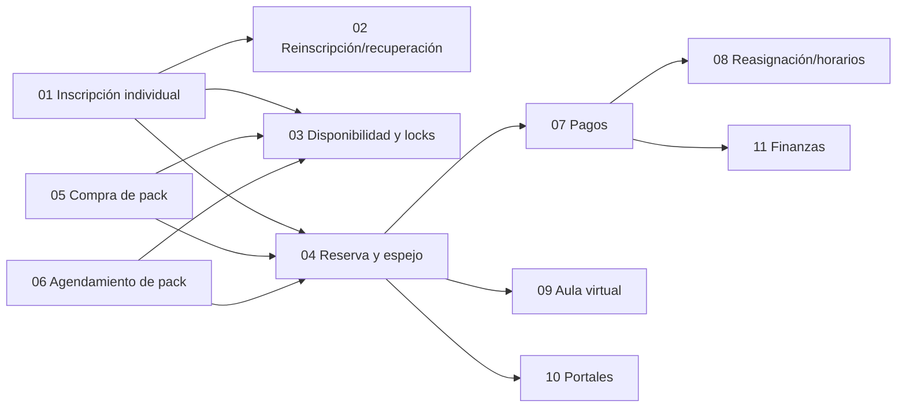

# Índice de flujos del sistema

> Leer esta tabla y la ficha del flujo **antes de tocar código**.
> Estados: 🟢 verificado · 🟡 verificado por código (pendiente DEV/revisión) · 🔴 desactualizado · ⚪ pendiente.

| # | Flujo | Estado | Última verificación | Archivos clave | Deudas |
|---|---|---|---|---|---|
| 01 | Inscripción individual | 🟡 | 19/11/2026 (código) | `InscripcionView.jsx`, `AuthService.js`, `ReservaService.js`, `LockService.js` | R-PIN-PII (ADR-001), B123 |
| 02 | Reinscripción y recuperación | 🟡 | 19/11/2026 (código) | `InscripcionView.jsx`, `ReservaService.js`, `AuthService.js`, `firestore.rules` | R-PIN-PII, B123 |
| 03 | Disponibilidad y locks | ⚪ | — | `useOcupacionConfirmada.js`, `useDisponibilidad.js`, `LockService.js` | rate limit, cuota Spark |
| 04 | Reserva y espejo `ocupacionConfirmada` | ⚪ | — (BUG-2 desplegado) | `ReservaService.js`, `solapamientoHelpers.js`, `ocupacionRepository.js` | slotsInstructor, cross-check admin |
| 05 | Compra de pack | ⚪ | — | `ReservaService.crearReservaPack`, `Paso2Pack.jsx` | — |
| 06 | Agendamiento de pack | ⚪ | — | `AgendarPackView.jsx`, `useDisponibilidadPack.js`, `ReservaService.agendarSiguienteCursoPack` | — |
| 07 | Aprobación / rechazo / corrección de pagos | ⚪ | — | `AdminReservaDetalle.jsx`, `ReservaService` (pack) | — |
| 08 | Reasignación de tutor / cambio de horario / D2 | ⚪ | — (BUG-1 desplegado) | `AdminReservaDetalle.jsx` | cross-check admin |
| 09 | Aula virtual y sesiones | ⚪ | — | `AulaVirtualView.jsx`, `useSessionTimer.js` | — |
| 10 | Portales (estudiante / instructor / proveedor) | ⚪ | — | `modules/estudiante`, `InstructorPanel`, `ProveedorPanel` | — |
| 11 | Finanzas y movimientos | ⚪ | — | `AdminFinanzas.jsx`, `FirestoreProvider.saveMovimiento` | regla `movimientos.create` |
| 12 | Teóricos | ⚪ | — | `InscripcionTeoricoView.jsx`, `AdminAccesoTeoricoDetalle.jsx` | — |
| 13 | Operación: deploy, backups, entornos | ⚪ | — | `firebase.json`, `scripts/`, `docs/MIGRACION_PRODUCCION.md` | paridad de config |

## Mapa de dependencias (resumen)

## Reglas de actualización
1. Si cambia el código de un flujo → actualizar su ficha en el mismo release.
2. Si aparece una decisión de riesgo → crear ADR y enlazarlo.
3. Si una ficha queda 🔴 → no se toca el flujo hasta verificarla y actualizarla.
4. Las fichas se editan en DEV y se sincronizan a PROD.

## Fichas disponibles
- `01-inscripcion-individual.md`
- `02-reinscripcion-recuperacion.md`

## Pendiente de documentar (prioridad)
1. 03 Disponibilidad y locks.
2. 04 Reserva y espejo.
3. 07 Pagos.
4. 05/06 Packs.
5. Resto.
