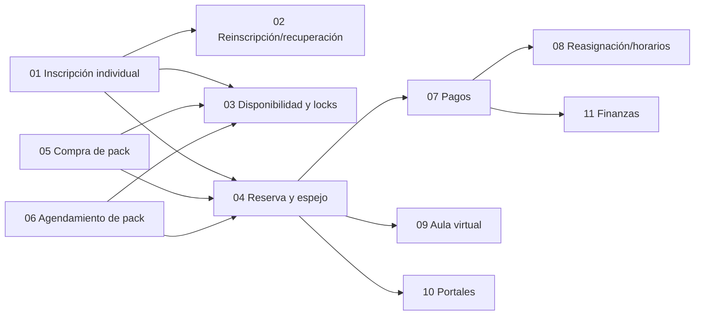

# Índice de flujos del sistema

> Leer esta tabla y la ficha del flujo **antes de tocar código**.
> Estados: 🟢 verificado · 🟡 verificado por código (pendiente DEV/revisión) · 🔴 desactualizado · ⚪ pendiente.

| # | Flujo | Estado | Última verificación | Archivos clave | Deudas |
|---|---|---|---|---|---|
| 01 | Inscripción individual | 🟡 | 19/11/2026 (código) | `InscripcionView.jsx`, `AuthService.js`, `ReservaService.js`, `LockService.js` | R-PIN-PII (ADR-001), B123 |
| 02 | Reinscripción y recuperación | 🟡 | 19/11/2026 (código) | `InscripcionView.jsx`, `ReservaService.js`, `AuthService.js`, `firestore.rules` | R-PIN-PII, B123 |
| 03 | Disponibilidad y locks | 🟡 | 19/11/2026 (código) | `useOcupacionConfirmada.js`, `useDisponibilidad.js`, `useDisponibilidadPack.js`, `LockService.js` | B-RATELIMIT-LOCKS, B-ALERTA-CUOTA, B-ESPACIO-LIMITE-100 |
| 04 | Reserva y espejo `ocupacionConfirmada` | 🟡 | 19/11/2026 (código + auditorías) | `ReservaService.js`, `solapamientoHelpers.js`, `ocupacionRepository.js`, `AdminReservaDetalle.jsx` | B-SLOTS-INSTRUCTOR, B-CROSSCHECK-ADMIN, B-ESPEJO-FANTASMA |
| 05 | Compra de pack | 🟡 | 19/11/2026 (código) | `PacksPublicosView.jsx`, `VistaPacks.jsx`, `InscripcionView.jsx`, `ReservaService.crearReservaPack` | B-PACK-RULES-OWNER, B-PACK-RULES-CHILD, B-PACK-PRECIOS-CLIENTE, B-PACK-PRECIO-TEORICOS, B-PACK-DOBLE-COMPRA |
| 06 | Agendamiento de pack | 🟡 | 19/11/2026 (código) | `AgendarPackView.jsx`, `useDisponibilidadPack.js`, `ReservaService.agendarSiguienteCursoPack`, `avanzarPackTrasCompletarCurso` | B-PACK-RULES-OWNER, B-PACK-RULES-CHILD, B-PACK-AVANCE-FIRE-AND-FORGET |
| 07 | Aprobación / rechazo / corrección de pagos | 🟡 | 19/11/2026 (código) | `AdminReservaDetalle.jsx`, `ReservaService.js`, `CorreccionPagoService.js`, `CorregirPagoView.jsx` | B-ESPEJO-FANTASMA, B-MOVIMIENTOS-ATOMICOS, B-INTENTOS-CORRECCION |
| 08 | Reasignación de tutor / cambio de horario / D2 | ⚪ | — (BUG-1 desplegado) | `AdminReservaDetalle.jsx` | cross-check admin |
| 09 | Aula virtual y sesiones | ⚪ | — | `AulaVirtualView.jsx`, `useSessionTimer.js` | — |
| 10 | Portales (estudiante / instructor / proveedor) | ⚪ | — | `modules/estudiante`, `InstructorPanel`, `ProveedorPanel` | — |
| 11 | Finanzas y movimientos | ⚪ | — | `AdminFinanzas.jsx`, `FirestoreProvider.saveMovimiento` | regla `movimientos.create` |
| 12 | Teóricos | ⚪ | — | `InscripcionTeoricoView.jsx`, `AdminAccesoTeoricoDetalle.jsx` | — |
| 13 | Operación: deploy, backups, entornos | ⚪ | — | `firebase.json`, `scripts/`, `docs/MIGRACION_PRODUCCION.md` | paridad de config |

## Mapa de dependencias (resumen)

## Hallazgos detectados al documentar
- **Contradicción de `instructoresPermitidos`:** el flujo individual es **fail-closed** (`InscripcionView.jsx:105-109`) y el de packs es **fail-open** (`useDisponibilidadPack.js:43-50`), aunque `BITACORA_EXPERIENCIAL.md` afirma que quedaron homologados. No se tocó; requiere dictamen FIRE/MAMBA.
- **PIN mostrado:** la memoria dice “tras Paso 1”; el código demuestra que solo se muestra **después del pago** (`InscripcionView.jsx:1699-1710`). Documentado en FLUJO-01/02.
- **Campo `reserva.pin`:** se escribe pero **no se lee**; es una segunda copia del PIN visible para instructores.
- **Movimiento de ingreso no atómico:** en la aprobación individual se crea después del commit; si falla, el pago queda aprobado sin movimiento (`AdminReservaDetalle.jsx:171`). En packs no se crea movimiento. Deuda `B-MOVIMIENTOS-ATOMICOS`.
- **Límite de 3 intentos solo UI:** `rechazarPago` no valida el tope; la regla tampoco. Deuda `B-INTENTOS-CORRECCION`.
- **`estadoCurso: 'En Curso'` al aprobar:** el SSOT (`getEstadoLogico`) lo ignora y devuelve `asignada`; dato engañoso.
- **`rechazadoEn`:** número en individual, `Timestamp` en packs.
- **Reglas de packs permiten autoaprobación (CRÍTICO):** el dueño de `reservasPack` puede actualizar cualquier campo, incluido `estadoPago`/precio/vencimiento (`firestore.rules:243-251`); además la child `pack_sub` puede nacer `Aprobado` sin validar que la maestra esté aprobada (`:107-133`). Deudas `B-PACK-RULES-OWNER` y `B-PACK-RULES-CHILD`.
- **Precio de pack con teóricos:** la UI suma los teóricos si `sumarTeoricosAlPrecio`, pero `crearReservaPack` calcula solo con `pack.cursoIds`; `pagoTotalMoneda` y `pagoTotalVES` pueden divergir. Deuda `B-PACK-PRECIO-TEORICOS`.
- **Precios/comisiones desde el cliente:** el backend usa `cursoSnapshot` enviado por el navegador; las reglas solo exigen `precio > 0`. Deuda `B-PACK-PRECIOS-CLIENTE`.
- **Avance de pack fire-and-forget:** si falla, el pack queda en el curso actual sin reintento. Deuda `B-PACK-AVANCE-FIRE-AND-FORGET`.
- **Doble compra de pack:** el chequeo de pack activo es previo a la transacción y fail-open. Deuda `B-PACK-DOBLE-COMPRA`.
- **Auto-jump desactivado en packs:** `AgendarPackView.jsx:302` neutraliza el salto automático a la primera fecha libre.

## Reglas de actualización
1. Si cambia el código de un flujo → actualizar su ficha en el mismo release.
2. Si aparece una decisión de riesgo → crear ADR y enlazarlo.
3. Si una ficha queda 🔴 → no se toca el flujo hasta verificarla y actualizarla.
4. Las fichas se editan en DEV y se sincronizan a PROD.

## Fichas disponibles
- `01-inscripcion-individual.md`
- `02-reinscripcion-recuperacion.md`
- `03-disponibilidad-locks.md`
- `04-reserva-y-espejo.md`
- `05-compra-pack.md`
- `06-agendamiento-pack.md`
- `07-aprobacion-rechazo-pagos.md`

## Pendiente de documentar (prioridad)
1. 08 Reasignación de tutor / cambio de horario / D2.
2. 09 Aula virtual y sesiones.
3. 11 Finanzas y movimientos.
4. Resto (10, 12, 13).
